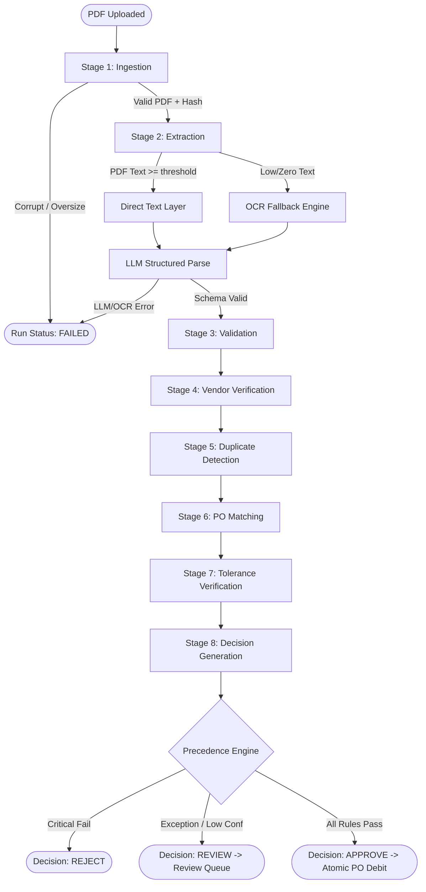

# 05 — Business Workflow & Eight-Stage Pipeline Architecture

## 1. Core Architectural Principle: Orthogonal Status Separation

InvoiceDesk strictly separates **three independent state dimensions** so that infrastructure retries or human overrides never corrupt historical truth:

1. **`processing_status` (Execution Axis — on `processing_runs` & cached on `invoices`):**
   `QUEUED` → `RUNNING` → `COMPLETED` | `FAILED`
2. **`business_decision` (Automated Policy Axis — on `decisions`):**
   `PENDING` → `APPROVE` | `REVIEW` | `REJECT`
3. **`review_status` (Human Resolution Axis — on `invoices` & `review_actions`):**
   `NOT_REQUIRED` (for auto-`APPROVE` or auto-`REJECT`) | `PENDING_REVIEW` (for `REVIEW`) → `APPROVED_BY_HUMAN` | `REJECTED_BY_HUMAN`

> **Rule:** When an AP Manager overrides a `REVIEW` invoice to `APPROVED_BY_HUMAN`, the underlying `Decision.outcome` remains `REVIEW` forever. Audit queries can always distinguish straight-through approvals from human-overridden approvals.

---

## 2. Eight-Stage Pipeline Mermaid Workflow

---

## 3. Detailed Stage-by-Stage Specifications

Every stage follows a uniform execution contract:
1. Persist `stage_events` row with `status = STARTED` and emit SSE `stage_started`.
2. Execute stage logic deterministically (or via provider-abstracted extraction in Stage 2).
3. Persist `stage_events` row with `status = COMPLETED` (or `FAILED` / `WARNING`), `duration_ms`, `summary`, and `evidence_json`, then emit SSE `stage_completed` (or `stage_failed`).

> **Important:** Stages `3` through `7` are **non-halting evaluators**. Even if Stage 4 flags an unverified vendor or Stage 5 detects a duplicate, the pipeline still executes Stages 6 and 7 (where feasible) so Stage 8 collects *all* diagnostic evidence in one pass rather than hiding downstream issues. Only infrastructure/unparseable failures in Stages 1–2 halt the run as `FAILED`.

---

### Stage 1: Ingestion
- **Input:** Raw uploaded multipart file bytes, original filename, uploader `user_id`, `run_id`.
- **Processing Logic:**
  1. Verify file size (`> 0` and `<= max_upload_bytes`, default 25 MB).
  2. Verify `%PDF-` magic header bytes and structural PDF readability (`pypdf` / `pypdfium2` page count check; reject password-encrypted PDFs without key).
  3. Compute `SHA-256` cryptographic hash of exact file bytes.
  4. Persist sanitized PDF to isolated object/file storage (`storage/invoices/{invoice_id}/{sha256}.pdf`)—never using the user-supplied filename in the filesystem path.
  5. Create/update `invoices` and `processing_runs` (`PROCESSING` / `RUNNING`).
- **Output:** `invoice_id`, `file_sha256`, `page_count`, `file_size_bytes`, `storage_key`.
- **Success Conditions:** Valid readable PDF stored atomically on disk and DB metadata committed.
- **Failure Conditions:** Non-PDF disguised with `.pdf` extension, corrupt/truncated PDF EOF, encrypted/password-protected PDF, disk write error.
- **Evidence Generated:** `{ "file_sha256": "...", "page_count": 2, "mime_verified": "application/pdf", "size_bytes": 184320 }`.
- **Retry Behavior:** On failure, user must upload a valid unencrypted PDF (retrying an invalid binary fails deterministically).
- **Database Events:** `invoices` insert (if new), `processing_runs` update (`current_stage = 1`), `stage_events` (`STAGE_1_INGESTION`: `STARTED` → `COMPLETED` | `FAILED`).
- **UI Representation:** Stage 1 badge turns green with `"Validated 2-page PDF (180 KB)"`.

---

### Stage 2: Extraction
- **Input:** `storage_key`, `page_count`, configured `ocr_min_chars_per_page` (`50`), `ExtractionProvider`.
- **Processing Logic:**
  1. Attempt native PDF text extraction per page (`pypdf`/`pdfplumber`).
  2. Calculate average non-whitespace characters per page.
  3. **OCR Fallback Decision:** If `avg_chars_per_page < 50` (scanned/image PDF) OR `force_ocr == true`, render pages at `300 DPI` via `pypdfium2` and run Tesseract OCR (`pytesseract`) to produce `ocr_text` + page-level OCR mean confidence.
  4. Send sanitized extracted text (and page images if vision-assisted mode enabled for low-OCR scans) inside strict untrusted-data delimiters to the `ExtractionProvider` (`gemini-2.5-flash` default).
  5. Validate LLM response against strict Pydantic `ExtractedInvoicePayload` schema (reject hallucinated fields, ensure `null` for missing values).
  6. Persist raw extraction JSON, `extraction_mode` (`NATIVE_TEXT` | `OCR` | `HYBRID`), `invoice_lines`, and per-field confidence scores.
- **Output:** Normalized `ExtractedInvoicePayload` (`vendor_name`, `invoice_number`, `dates`, `po_number`, `currency`, `subtotal`, `tax`, `total`, `document_type`, `line_items[]`, `field_confidence{}`, `evidence_snippets{}`).
- **Success Conditions:** Valid JSON conforming to `ExtractedInvoicePayload` parsed and stored. (Note: missing invoice fields like `invoice_number: null` is still a **Stage 2 Success**—the *Decision Engine* handles missing fields, not an infrastructure crash.)
- **Failure Conditions:** OCR engine crash, LLM provider timeout/5xx after 2 internal exponential retries, malformed non-JSON LLM output.
- **Evidence Generated:** `{ "extraction_mode": "OCR", "native_chars_per_page": 0, "ocr_avg_confidence": 0.87, "provider": "gemini-2.5-flash", "latency_ms": 3420, "raw_text_preview": "..." }`.
- **Retry Behavior:** Idempotent retry re-executes Stage 2 from `storage_key`, overwriting/creating a new `ProcessingRun` without re-uploading.
- **Database Events:** Update `invoices` extracted columns, replace/insert `invoice_lines` for run, insert `stage_events` (`STAGE_2_EXTRACTION`).
- **UI Representation:** Stage 2 displays `"OCR Fallback (2 pages, 87% OCR conf)"` or `"Native PDF Text"`, immediately populating the right-hand Extracted Data tab.

---

### Stage 3: Validation (Structural & Financial Arithmetic)
- **Input:** `ExtractedInvoicePayload`, `confidence_threshold` (from `application_settings`, default `0.85`).
- **Processing Logic:**
  1. Check presence of required fields: `vendor_name`, `invoice_number`, `invoice_date`, `currency`, `total`.
  2. Convert all monetary values to `Decimal` (quantized to 4 decimal places for calculation, 2 for currency display).
  3. Check date sanity (`due_date >= invoice_date` if both present; `invoice_date` not absurdly in future).
  4. Verify line-item arithmetic (if `line_items` present): `sum(line.line_total) == subtotal` (within `$0.02` rounding tolerance for per-line tax/rounding).
  5. Verify header arithmetic: `subtotal + tax_amount - discount_amount == total` (exact `Decimal` check, rounding tolerance `<= $0.02`).
  6. Evaluate field-level confidence for critical fields (`vendor_name`, `invoice_number`, `total`, `po_number`, `currency`) against `confidence_threshold`.
- **Output:** `ValidationResult` (`missing_fields[]`, `arithmetic_valid`, `arithmetic_delta`, `low_confidence_fields[]`, `is_credit_note`).
- **Success Conditions:** Validation completes cleanly and emits structured check results (even if violations are found—violations are recorded as flags for Stage 8).
- **Failure Conditions:** Unexpected internal type/database error.
- **Evidence Generated:** `{ "required_present": false, "missing_fields": ["invoice_number"], "header_math": "1000.00 + 80.00 = 1080.00 (delta: 0.00)", "low_confidence_fields": [{"field": "total", "conf": 0.72}] }`.
- **Retry Behavior:** Deterministic; re-runs cleanly on pipeline retry.
- **Database Events:** `stage_events` (`STAGE_3_VALIDATION`).
- **UI Representation:** Stage 3 shows `"Arithmetic Verified ($0.00 delta)"` or warning `"1 missing field, 1 low-confidence field"`.

---

### Stage 4: Vendor Verification
- **Input:** Extracted `vendor_name`, `vendor_tax_id` (if extracted), `vendors` table.
- **Processing Logic:**
  1. Normalize extracted vendor name (lowercase, strip legal suffixes `Inc.`, `LLC`, `Ltd.`, punctuation, extra whitespace).
  2. Query `vendors` for exact `canonical_name` match, exact `tax_id` match, or exact `aliases` JSONB array match.
  3. If no exact match, run fuzzy similarity (`Levenshtein / trigram ratio >= 0.85`) against canonical names and aliases to identify candidate matches.
  4. Inspect matched vendor's `verification_status` (`APPROVED`, `UNVERIFIED`, `BLOCKED`).
- **Output:** `VendorVerificationResult` (`matched_vendor_id`, `match_method`: `EXACT_NAME | ALIAS | TAX_ID | FUZZY | NONE`, `similarity_score`, `vendor_status`).
- **Success Conditions:** Vendor lookup completes (matched or cleanly recorded as `NONE`).
- **Failure Conditions:** DB query failure.
- **Evidence Generated:** `{ "extracted_vendor": "Acme Cloud Inc", "matched_vendor_id": "uuid", "canonical_name": "Acme Cloud Services LLC", "match_method": "ALIAS", "vendor_status": "APPROVED" }`.
- **Retry Behavior:** Deterministic; picks up newly added vendors/aliases if retried after Admin updates `Vendors`.
- **Database Events:** Update `invoices.vendor_id` (if matched), `stage_events` (`STAGE_4_VENDOR_VERIFICATION`).
- **UI Representation:** Stage 4 shows `"Matched 'Acme Cloud Services LLC' via Alias (APPROVED)"` or warning `"Unrecognized vendor"`.

---

### Stage 5: Duplicate Detection
- **Input:** `invoice_id`, `file_sha256`, `matched_vendor_id`, `invoice_number`, `total`, `invoice_date`.
- **Processing Logic:**
  1. **Exact Binary Duplicate Check:** Query `invoices` where `file_sha256 == current.file_sha256` AND `id != current.id` AND latest decision is not `REJECT` (or check all prior non-failed invoices, flagging clearly).
  2. **Semantic Business Duplicate Check (Edge Case E2):** Normalize `invoice_number` (uppercase, strip spaces/hyphens/leading `#`) and query `invoices` where `vendor_id == matched_vendor_id` AND `normalized_invoice_number == current_norm` AND `id != current.id`.
  3. **Near-Duplicate Heuristic (Secondary Warning):** Same `vendor_id` + exact `total` + `invoice_date` within `±3 days` with a different invoice number → emits a `NEAR_DUPLICATE_WARNING` for `REVIEW` rather than hard `REJECT`.
- **Output:** `DuplicateCheckResult` (`is_exact_file_duplicate`, `is_business_duplicate`, `is_near_duplicate`, `conflicting_invoice_id`, `conflicting_invoice_number`, `conflicting_filename`).
- **Success Conditions:** Check completes with zero or more conflicting references.
- **Failure Conditions:** DB error.
- **Evidence Generated:** `{ "file_hash_match": false, "business_key_match": true, "match_key": "vendor:acme|INV20260419", "conflicting_invoice_id": "uuid", "conflicting_filename": "acme_april_scan.pdf" }`.
- **Retry Behavior:** Deterministic.
- **Database Events:** `stage_events` (`STAGE_5_DUPLICATE_DETECTION`).
- **UI Representation:** Stage 5 shows `"No duplicates found"` or red alert `"Duplicate of INV-2026-0419 (uploaded as acme_april_scan.pdf)"`.

---

### Stage 6: Purchase Order (PO) Matching
- **Input:** Extracted `po_number`, `matched_vendor_id`, `currency`, `total`, `line_items`, `purchase_orders` table.
- **Processing Logic:**
  1. **Explicit PO Lookup:** If `po_number` is extracted, normalize (`PO-2026-104` / `PO2026104`) and look up exact PO record.
  2. **Vendor Cross-Check:** Verify matched PO belongs to `matched_vendor_id` (if vendor matched).
  3. **Implied PO Fallback (when `po_number` is `null`):** Query open POs for `matched_vendor_id` with matching `currency`.
     - If `0` open POs → `NO_PO_FOUND`.
     - If `1` open PO and remaining balance >= invoice total (or line descriptions overlap `>= 0.5`) → `IMPLIED_CANDIDATE` (still flagged for `REVIEW` unless policy allows implied matching—default: requires `REVIEW` for missing explicit PO).
     - If `>= 2` open POs → `AMBIGUOUS_PO_MATCH` (lists all candidate POs in evidence, routes to `REVIEW`).
  4. Inspect `po.status` (`OPEN`, `PARTIALLY_CONSUMED`, `FULLY_CONSUMED`, `CLOSED`).
- **Output:** `PoMatchResult` (`match_status`: `EXACT | IMPLIED | AMBIGUOUS | NOT_FOUND | VENDOR_MISMATCH`, `matched_po_id`, `candidate_po_ids[]`, `po_status`, `po_currency`, `po_original_amount`, `prior_consumed_amount`).
- **Success Conditions:** Match status determined with full candidate evidence.
- **Failure Conditions:** DB error.
- **Evidence Generated:** `{ "extracted_po": "PO-2026-104", "matched_po_id": "uuid", "po_status": "PARTIALLY_CONSUMED", "po_original": "50000.00", "prior_consumed": "18000.00" }`.
- **Retry Behavior:** Deterministic; picks up newly created POs on retry.
- **Database Events:** Update `invoices.purchase_order_id` (if unambiguous), `stage_events` (`STAGE_6_PO_MATCHING`).
- **UI Representation:** Stage 6 shows `"Matched PO-2026-104 (Open, $32,000.00 remaining)"`.

---

### Stage 7: Tolerance Verification
- **Input:** `PoMatchResult`, `invoice.total`, `invoice.currency`, `invoice.document_type`, `application_settings` (`tolerance_pct`, `tolerance_abs`).
- **Processing Logic (Exact `Decimal` Math):**
  1. Verify currency equality (`invoice.currency == po.currency`).
  2. Compute `remaining_balance = po.original_amount - po.prior_consumed_amount`.
  3. Compute `variance_amount = invoice.total - remaining_balance` (for single-invoice full POs, also track `invoice.total` vs `remaining_balance`).
     - *Case A (Invoice <= Remaining Balance):* Within remaining PO commitment! Check if it's a split/partial invoice (`invoice.total < remaining_balance` → valid partial draw; remaining balance stays positive).
     - *Case B (Invoice > Remaining Balance):* Compute overrun `overrun_amount = invoice.total - remaining_balance` and `overrun_pct = (overrun_amount / po.original_amount) * 100`.
     - Compute allowed tolerance cap: `allowed_cap = min(po.original_amount * (tolerance_pct / 100), tolerance_abs)`.
     - If `overrun_amount <= allowed_cap` → `WITHIN_TOLERANCE` (passes or minor warning per setting; default: passes up to `$10.00` / `2%`).
     - If `overrun_amount > allowed_cap` → `TOLERANCE_EXCEEDED`.
  4. Handle Credit Notes (`document_type == CREDIT_NOTE`): Negative/credit adjustments route to `REVIEW` with credit note verification evidence (do not blindly auto-approve).
- **Output:** `ToleranceResult` (`currency_match`, `remaining_before`, `remaining_after`, `overrun_amount`, `overrun_pct`, `allowed_cap`, `within_tolerance`, `is_partial_invoice`).
- **Success Conditions:** Exact calculations completed and serialized as strings in evidence.
- **Failure Conditions:** Division by zero (guarded if `po.original_amount <= 0`).
- **Evidence Generated:** `{ "po_original": "10000.00", "prior_consumed": "6000.00", "remaining_before": "4000.00", "invoice_total": "4005.00", "overrun": "5.00", "allowed_cap": "10.00", "within_tolerance": true }`.
- **Retry Behavior:** Deterministic; reflects current settings and latest PO balance.
- **Database Events:** `stage_events` (`STAGE_7_TOLERANCE_VERIFICATION`).
- **UI Representation:** Stage 7 displays exact equation breakdown (`$4,000.00 remaining vs $4,005.00 billed → +$5.00 within $10.00 cap`).

---

### Stage 8: Decision Generation (Atomic Transaction)
- **Input:** Outputs of Stages 3–7, `application_settings`, `ProcessingRun`.
- **Processing Logic:**
  1. Evaluate all deterministic rules `R-01` through `R-16` (defined in [`06-extraction-and-decision-engine.md`](./06-extraction-and-decision-engine.md)).
  2. Apply Precedence Policy: `REJECT` > `REVIEW` > `APPROVE`.
  3. **Inside a single PostgreSQL `SERIALIZABLE` / row-locked (`SELECT ... FOR UPDATE` on `purchase_orders`) transaction:**
     - Insert `decisions` record (`outcome`, `primary_reason_code`, `triggered_rules[]`, `explanation`, `evidence_snapshot`).
     - If `outcome == APPROVE` and `matched_po_id` is set: re-verify `remaining_balance` under lock (guarding against concurrent upload race conditions!) and increment `po.consumed_amount += invoice.total` (updating `po.status` to `PARTIALLY_CONSUMED` or `FULLY_CONSUMED`).
     - Update `invoices.latest_decision_id`, `invoices.business_decision`, and `invoices.review_status` (`PENDING_REVIEW` if `REVIEW`, else `NOT_REQUIRED`).
     - Update `processing_runs` (`status = COMPLETED`, `completed_at`, `duration_ms`).
     - Append `DECISION_GENERATED` record to `audit_logs`.
- **Output:** Persisted `Decision`, updated `Invoice`, updated `PurchaseOrder` (if approved), `ProcessingRun` marked `COMPLETED`.
- **Success Conditions:** Atomic commit succeeds; SSE emits `stage_completed` (Stage 8) + `run_completed`.
- **Failure Conditions:** Concurrent PO exhaustion detected under lock → re-evaluates rule `R-07` cleanly as `REVIEW` (over-PO) rather than crashing; DB failure rolls back cleanly and marks run `FAILED`.
- **Evidence Generated:** Complete rule evaluation table + primary reason code + plain-English explanation.
- **Retry Behavior:** Re-running a completed invoice creates a *new* `ProcessingRun` (`run_number + 1`) and new `Decision` without deleting historical runs; if an invoice already auto-approved and consumed a PO, re-running is idempotent (will not double-debit the PO!).
- **UI Representation:** Stage 8 completes; top Decision Banner animates smoothly into `APPROVE`, `REVIEW`, or `REJECT` with full explanation.
