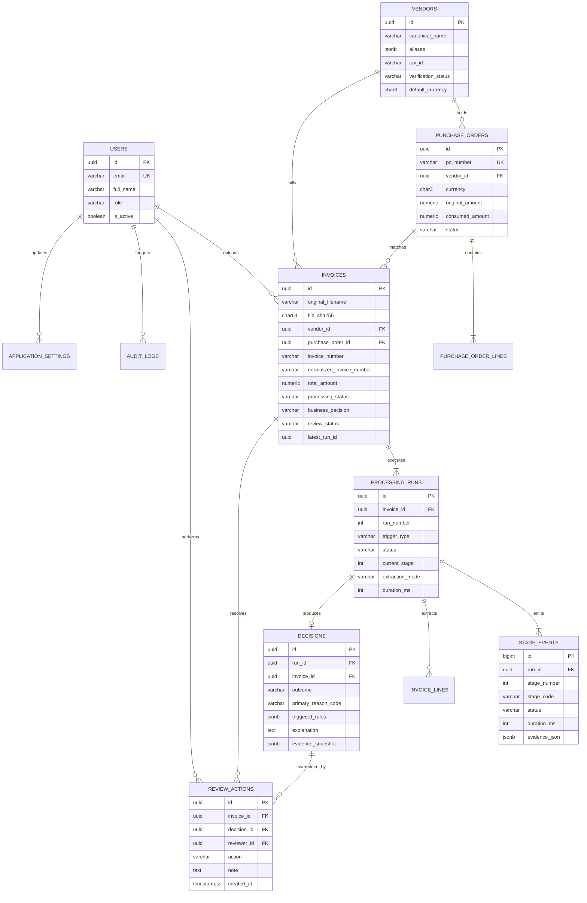

# 09 — Database Design & Data Model (PostgreSQL)

## 1. Data Modeling Principles

1. **Exact Monetary Precision:** Every currency amount uses `NUMERIC(14, 4)` (14 total digits, 4 fractional digits) in PostgreSQL and `Decimal` in Python. Floating-point (`FLOAT` / `REAL`) is strictly prohibited for monetary columns.
2. **Orthogonal Status Columns:** `processing_status`, `business_decision`, and `review_status` live in distinct columns/tables so pipeline retries and human overrides never overwrite automated history.
3. **Multi-Run Support:** One `Invoice` can have `1..N` `ProcessingRun` records (`run_number = 1, 2, ...`). Each run owns its own `StageEvent[]`, `InvoiceLine[]` snapshot, and `Decision` record.
4. **Immutable Audit & Decision History:** `decisions`, `review_actions`, and `audit_logs` are append-only (`INSERT`-only; no `UPDATE`/`DELETE` in application code).

---

## 2. Entity-Relationship Diagram (Mermaid)

---

## 3. Complete Table Specifications

### 3.1 `users`
| Column | Type | Constraints | Notes |
| :--- | :--- | :--- | :--- |
| `id` | `UUID` | `PK, DEFAULT gen_random_uuid()` | |
| `email` | `VARCHAR(255)` | `NOT NULL, UNIQUE` | Normalized lowercase |
| `full_name` | `VARCHAR(120)` | `NOT NULL` | |
| `password_hash` | `TEXT` | `NOT NULL` | Argon2id hash |
| `role` | `VARCHAR(20)` | `NOT NULL, CHECK (role IN ('OPERATOR','REVIEWER','ADMIN'))` | RBAC role |
| `theme_preference` | `VARCHAR(10)` | `NOT NULL, DEFAULT 'light'` | `'light' | 'dark' | 'system'` |
| `is_active` | `BOOLEAN` | `NOT NULL, DEFAULT TRUE` | Soft disable |
| `created_at` | `TIMESTAMPTZ` | `NOT NULL, DEFAULT now()` | |
| `updated_at` | `TIMESTAMPTZ` | `NOT NULL, DEFAULT now()` | |

### 3.2 `vendors`
| Column | Type | Constraints | Notes |
| :--- | :--- | :--- | :--- |
| `id` | `UUID` | `PK` | |
| `vendor_code` | `VARCHAR(32)` | `NOT NULL, UNIQUE` | e.g., `V-001` |
| `canonical_name` | `VARCHAR(255)` | `NOT NULL` | Official legal name |
| `normalized_name` | `VARCHAR(255)` | `NOT NULL` | Lowercase stripped for matching |
| `aliases` | `JSONB` | `NOT NULL, DEFAULT '[]'::jsonb` | Array of known header variants |
| `tax_id` | `VARCHAR(64)` | `UNIQUE NULLS DISTINCT` | EIN / VAT ID |
| `default_currency` | `CHAR(3)` | `NOT NULL, DEFAULT 'USD'` | ISO-4127 |
| `verification_status` | `VARCHAR(20)` | `NOT NULL, CHECK (... IN ('APPROVED','UNVERIFIED','BLOCKED'))` | |
| `payment_terms_days` | `INTEGER` | `NOT NULL, DEFAULT 30` | |
| `created_at` | `TIMESTAMPTZ` | `NOT NULL, DEFAULT now()` | |
| `updated_at` | `TIMESTAMPTZ` | `NOT NULL, DEFAULT now()` | |
- **Indexes:** `GIN` index on `aliases`, B-tree on `normalized_name`, `verification_status`.

### 3.3 `purchase_orders`
| Column | Type | Constraints | Notes |
| :--- | :--- | :--- | :--- |
| `id` | `UUID` | `PK` | |
| `po_number` | `VARCHAR(64)` | `NOT NULL, UNIQUE` | e.g., `PO-2026-104` |
| `normalized_po_number` | `VARCHAR(64)` | `NOT NULL, UNIQUE` | Stripped uppercase |
| `vendor_id` | `UUID` | `NOT NULL, FK -> vendors(id) ON DELETE RESTRICT` | |
| `currency` | `CHAR(3)` | `NOT NULL, DEFAULT 'USD'` | |
| `original_amount` | `NUMERIC(14,4)` | `NOT NULL, CHECK (original_amount > 0)` | |
| `consumed_amount` | `NUMERIC(14,4)` | `NOT NULL, DEFAULT 0.0000, CHECK (consumed_amount >= 0)` | Incremented atomically on approval |
| `status` | `VARCHAR(24)` | `NOT NULL, CHECK (... IN ('OPEN','PARTIALLY_CONSUMED','FULLY_CONSUMED','CLOSED','CANCELLED'))` | |
| `issued_date` | `DATE` | `NOT NULL` | |
| `notes` | `TEXT` | `NULL` | |
| `created_at` | `TIMESTAMPTZ` | `NOT NULL, DEFAULT now()` | |
| `updated_at` | `TIMESTAMPTZ` | `NOT NULL, DEFAULT now()` | |
- **Computed Read Property:** `remaining_amount = GREATEST(0, original_amount - consumed_amount)`.
- **Indexes:** `(vendor_id, status)`, `normalized_po_number`.

### 3.4 `purchase_order_lines`
| Column | Type | Constraints | Notes |
| :--- | :--- | :--- | :--- |
| `id` | `UUID` | `PK` | |
| `purchase_order_id` | `UUID` | `NOT NULL, FK -> purchase_orders(id) ON DELETE CASCADE` | |
| `line_number` | `INTEGER` | `NOT NULL` | |
| `description` | `TEXT` | `NOT NULL` | |
| `quantity` | `NUMERIC(14,4)` | `NOT NULL` | |
| `unit_price` | `NUMERIC(14,4)` | `NOT NULL` | |
| `line_total` | `NUMERIC(14,4)` | `NOT NULL` | |
- **Unique Constraint:** `UNIQUE (purchase_order_id, line_number)`.

### 3.5 `invoices`
| Column | Type | Constraints | Notes |
| :--- | :--- | :--- | :--- |
| `id` | `UUID` | `PK` | |
| `uploaded_by` | `UUID` | `NOT NULL, FK -> users(id)` | |
| `original_filename` | `VARCHAR(255)` | `NOT NULL` | Display only; never used in disk path |
| `storage_key` | `VARCHAR(512)` | `NOT NULL` | Isolated internal path |
| `file_sha256` | `CHAR(64)` | `NOT NULL` | Content fingerprint |
| `file_size_bytes` | `BIGINT` | `NOT NULL` | |
| `page_count` | `INTEGER` | `NULL` | Set in Stage 1 |
| `document_type` | `VARCHAR(20)` | `NOT NULL, DEFAULT 'INVOICE'` | `'INVOICE' | 'CREDIT_NOTE' | 'UNKNOWN'` |
| `vendor_id` | `UUID` | `NULL, FK -> vendors(id)` | Matched vendor (Stage 4) |
| `extracted_vendor_name` | `VARCHAR(255)` | `NULL` | Raw extracted string |
| `purchase_order_id` | `UUID` | `NULL, FK -> purchase_orders(id)` | Matched PO (Stage 6) |
| `extracted_po_number` | `VARCHAR(64)` | `NULL` | Raw extracted PO ref |
| `invoice_number` | `VARCHAR(128)` | `NULL` | Raw extracted invoice # |
| `normalized_invoice_number` | `VARCHAR(128)` | `NULL` | Uppercase alphanumeric for dup detection |
| `invoice_date` | `DATE` | `NULL` | |
| `due_date` | `DATE` | `NULL` | |
| `currency` | `CHAR(3)` | `NULL` | |
| `subtotal_amount` | `NUMERIC(14,4)` | `NULL` | |
| `tax_amount` | `NUMERIC(14,4)` | `NULL` | |
| `discount_amount` | `NUMERIC(14,4)` | `NULL` | |
| `total_amount` | `NUMERIC(14,4)` | `NULL` | |
| `overall_confidence` | `NUMERIC(5,4)` | `NULL` | e.g., `0.9420` |
| `po_consumed_applied` | `BOOLEAN` | `NOT NULL, DEFAULT FALSE` | Idempotency guard against double-debiting PO |
| `processing_status` | `VARCHAR(20)` | `NOT NULL, DEFAULT 'QUEUED'` | `'QUEUED' | 'RUNNING' | 'COMPLETED' | 'FAILED'` |
| `business_decision` | `VARCHAR(20)` | `NOT NULL, DEFAULT 'PENDING'` | `'PENDING' | 'APPROVE' | 'REVIEW' | 'REJECT'` |
| `review_status` | `VARCHAR(24)` | `NOT NULL, DEFAULT 'NOT_REQUIRED'` | `'NOT_REQUIRED' | 'PENDING_REVIEW' | 'APPROVED_BY_HUMAN' | 'REJECTED_BY_HUMAN'` |
| `assigned_reviewer_id` | `UUID` | `NULL, FK -> users(id)` | |
| `latest_run_id` | `UUID` | `NULL` | Points to current `processing_runs.id` |
| `latest_decision_id` | `UUID` | `NULL` | Points to current `decisions.id` |
| `created_at` | `TIMESTAMPTZ` | `NOT NULL, DEFAULT now()` | |
| `updated_at` | `TIMESTAMPTZ` | `NOT NULL, DEFAULT now()` | |
- **Indexes:** `file_sha256`, `(vendor_id, normalized_invoice_number)`, `(business_decision, review_status)`, `created_at DESC`.
- *(Note: We intentionally do NOT add a DB-level `UNIQUE` constraint on `(vendor_id, normalized_invoice_number)` because duplicate uploads MUST be accepted into Stage 1–5 and recorded cleanly as `REJECT (DUPLICATE_INVOICE)` with evidence rather than crashing on SQL `IntegrityError`!)*

### 3.6 `invoice_lines`
| Column | Type | Constraints | Notes |
| :--- | :--- | :--- | :--- |
| `id` | `UUID` | `PK` | |
| `invoice_id` | `UUID` | `NOT NULL, FK -> invoices(id) ON DELETE CASCADE` | |
| `run_id` | `UUID` | `NOT NULL, FK -> processing_runs(id) ON DELETE CASCADE` | Scoped per run |
| `line_number` | `INTEGER` | `NOT NULL` | |
| `description` | `TEXT` | `NOT NULL` | |
| `is_bundled` | `BOOLEAN` | `NOT NULL, DEFAULT FALSE` | |
| `quantity` | `NUMERIC(14,4)` | `NULL` | |
| `unit_price` | `NUMERIC(14,4)` | `NULL` | |
| `tax_amount` | `NUMERIC(14,4)` | `NULL` | |
| `line_total` | `NUMERIC(14,4)` | `NOT NULL` | |

### 3.7 `processing_runs`
| Column | Type | Constraints | Notes |
| :--- | :--- | :--- | :--- |
| `id` | `UUID` | `PK` | |
| `invoice_id` | `UUID` | `NOT NULL, FK -> invoices(id) ON DELETE CASCADE` | |
| `run_number` | `INTEGER` | `NOT NULL` | `1, 2, 3...` per invoice |
| `trigger_type` | `VARCHAR(20)` | `NOT NULL` | `'INITIAL' | 'RETRY' | 'REPROCESS'` |
| `triggered_by` | `UUID` | `NOT NULL, FK -> users(id)` | |
| `status` | `VARCHAR(20)` | `NOT NULL, DEFAULT 'QUEUED'` | `'QUEUED' | 'RUNNING' | 'COMPLETED' | 'FAILED'` |
| `current_stage` | `SMALLINT` | `NOT NULL, DEFAULT 0` | `0..8` |
| `extraction_mode` | `VARCHAR(20)` | `NULL` | `'NATIVE_TEXT' | 'OCR' | 'HYBRID'` |
| `raw_extracted_json` | `JSONB` | `NULL` | Exact validated extraction payload |
| `error_stage` | `SMALLINT` | `NULL` | Stage # where failure occurred |
| `error_message` | `TEXT` | `NULL` | Safe operator-readable error |
| `started_at` | `TIMESTAMPTZ` | `NULL` | |
| `completed_at` | `TIMESTAMPTZ` | `NULL` | |
| `duration_ms` | `INTEGER` | `NULL` | |
| `created_at` | `TIMESTAMPTZ` | `NOT NULL, DEFAULT now()` | |
- **Unique Constraint:** `UNIQUE (invoice_id, run_number)`.
- **Indexes:** `(invoice_id, run_number DESC)`, `(status, started_at DESC)`.

### 3.8 `stage_events`
| Column | Type | Constraints | Notes |
| :--- | :--- | :--- | :--- |
| `id` | `BIGSERIAL` | `PK` | Monotonic SSE `id` for `Last-Event-ID` replay |
| `run_id` | `UUID` | `NOT NULL, FK -> processing_runs(id) ON DELETE CASCADE` | |
| `stage_number` | `SMALLINT` | `NOT NULL, CHECK (stage_number BETWEEN 1 AND 8)` | |
| `stage_code` | `VARCHAR(40)` | `NOT NULL` | e.g., `STAGE_2_EXTRACTION` |
| `status` | `VARCHAR(20)` | `NOT NULL` | `'STARTED' | 'COMPLETED' | 'WARNING' | 'FAILED'` |
| `summary` | `TEXT` | `NOT NULL` | Human-readable timeline message |
| `duration_ms` | `INTEGER` | `NULL` | Populated on terminal stage event |
| `evidence_json` | `JSONB` | `NOT NULL, DEFAULT '{}'::jsonb` | Structured proof shown on stage expand |
| `created_at` | `TIMESTAMPTZ` | `NOT NULL, DEFAULT now()` | |
- **Index:** `(run_id, id ASC)` — powers instant SSE replay (`WHERE run_id = :id AND id > :last_event_id`).

### 3.9 `decisions`
| Column | Type | Constraints | Notes |
| :--- | :--- | :--- | :--- |
| `id` | `UUID` | `PK` | |
| `run_id` | `UUID` | `NOT NULL, UNIQUE, FK -> processing_runs(id) ON DELETE CASCADE` | 1:1 with completed run |
| `invoice_id` | `UUID` | `NOT NULL, FK -> invoices(id) ON DELETE CASCADE` | |
| `outcome` | `VARCHAR(16)` | `NOT NULL, CHECK (outcome IN ('APPROVE','REVIEW','REJECT'))` | Immutable automated outcome |
| `primary_reason_code` | `VARCHAR(64)` | `NOT NULL` | e.g., `TOLERANCE_EXCEEDED` |
| `triggered_rules` | `JSONB` | `NOT NULL` | Array of `{rule_id, reason_code, severity, decision, message}` |
| `explanation` | `TEXT` | `NOT NULL` | Complete human-readable rationale |
| `evidence_snapshot` | `JSONB` | `NOT NULL` | Frozen math, PO numbers, settings used at decision time |
| `created_at` | `TIMESTAMPTZ` | `NOT NULL, DEFAULT now()` | |

### 3.10 `review_actions`
| Column | Type | Constraints | Notes |
| :--- | :--- | :--- | :--- |
| `id` | `UUID` | `PK` | |
| `invoice_id` | `UUID` | `NOT NULL, FK -> invoices(id) ON DELETE CASCADE` | |
| `decision_id` | `UUID` | `NOT NULL, FK -> decisions(id)` | Preserves link to original automated decision |
| `reviewer_id` | `UUID` | `NOT NULL, FK -> users(id)` | |
| `action` | `VARCHAR(24)` | `NOT NULL, CHECK (action IN ('APPROVE_OVERRIDE','REJECT_OVERRIDE','ASSIGN','COMMENT'))` | |
| `note` | `TEXT` | `NOT NULL` | Mandatory (`>= 10` chars for overrides) |
| `created_at` | `TIMESTAMPTZ` | `NOT NULL, DEFAULT now()` | |

### 3.11 `audit_logs`
| Column | Type | Constraints | Notes |
| :--- | :--- | :--- | :--- |
| `id` | `BIGSERIAL` | `PK` | Append-only chronological sequence |
| `actor_id` | `UUID` | `NULL, FK -> users(id)` | `NULL` when `actor_type == 'SYSTEM'` |
| `actor_type` | `VARCHAR(16)` | `NOT NULL` | `'USER' | 'SYSTEM'` |
| `actor_role` | `VARCHAR(20)` | `NOT NULL` | `'OPERATOR' | 'REVIEWER' | 'ADMIN' | 'ENGINE'` |
| `action` | `VARCHAR(64)` | `NOT NULL` | e.g., `REVIEW_OVERRIDE_APPROVED` |
| `resource_type` | `VARCHAR(32)` | `NOT NULL` | `'INVOICE' | 'PURCHASE_ORDER' | 'VENDOR' | 'SETTINGS' | 'USER'` |
| `resource_id` | `UUID` | `NOT NULL` | |
| `original_decision` | `VARCHAR(16)` | `NULL` | Explicitly surfaced in Audit Trail UI |
| `new_decision` | `VARCHAR(24)` | `NULL` | |
| `details_json` | `JSONB` | `NOT NULL, DEFAULT '{}'::jsonb` | Before/after diff + note |
| `created_at` | `TIMESTAMPTZ` | `NOT NULL, DEFAULT now()` | |
- **Indexes:** `created_at DESC`, `(resource_type, resource_id)`, `action`.

### 3.12 `application_settings`
| Column | Type | Constraints | Notes |
| :--- | :--- | :--- | :--- |
| `id` | `SMALLINT` | `PK, CHECK (id = 1)` | Enforces singleton active config row |
| `workspace_name` | `VARCHAR(120)` | `NOT NULL, DEFAULT 'InvoiceDesk'` | |
| `default_currency` | `CHAR(3)` | `NOT NULL, DEFAULT 'USD'` | |
| `max_upload_mb` | `INTEGER` | `NOT NULL, DEFAULT 25` | |
| `ocr_min_chars_per_page` | `INTEGER` | `NOT NULL, DEFAULT 50` | |
| `force_ocr` | `BOOLEAN` | `NOT NULL, DEFAULT FALSE` | |
| `tolerance_pct` | `NUMERIC(5,2)` | `NOT NULL, DEFAULT 2.00` | Default `2.00%` |
| `tolerance_abs` | `NUMERIC(14,4)` | `NOT NULL, DEFAULT 10.0000` | Default `$10.00` |
| `tolerance_mode` | `VARCHAR(24)` | `NOT NULL, DEFAULT 'MIN_OF_PCT_AND_ABS'` | |
| `confidence_threshold` | `NUMERIC(4,3)` | `NOT NULL, DEFAULT 0.850` | Default `0.85` |
| `auto_approve_max_amount` | `NUMERIC(14,4)` | `NULL, DEFAULT 25000.0000` | `NULL` disables ceiling |
| `updated_by` | `UUID` | `NULL, FK -> users(id)` | |
| `updated_at` | `TIMESTAMPTZ` | `NOT NULL, DEFAULT now()` | |

---

## 4. Transaction Boundaries & Data Retention

- **PO Consumption Atomicity:** Both Stage 8 auto-approval and Reviewer `APPROVE_OVERRIDE` acquire `SELECT * FROM purchase_orders WHERE id = :po_id FOR UPDATE`, verify `invoice.po_consumed_applied == FALSE`, verify remaining balance, update `consumed_amount` + `status`, and set `invoice.po_consumed_applied = TRUE` in one commit.
- **Retention Policy:**
  - `audit_logs`, `decisions`, `review_actions`, and `invoices` financial metadata: **7 years** (standard AP compliance).
  - `stage_events` verbose payloads and orphaned failed PDFs: configurable archival after **180 days** without deleting financial `Decision` summaries.
