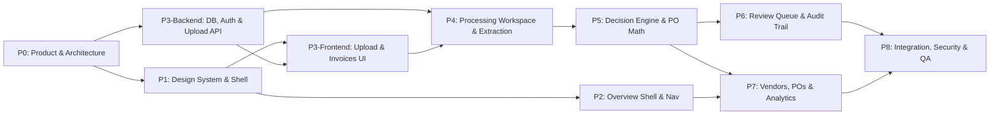

# 13 — Phased Implementation Roadmap (P0 – P8)

This roadmap sequences implementation into **9 independent, testable phases** designed to produce a genuinely executable end-to-end process early (by P4/P5) and harden into an enterprise-ready demo by P8—with zero circular dependencies.

---

## 1. Phase Dependency Graph

---

## 2. Phase-by-Phase Execution Plan

### P0 — Product Discovery & Architecture *(Current Phase)*
- **Scope:** Operational discovery, UX specs for 10 screens, 8-stage workflow, extraction/decision rules, edge cases `E1`–`E4`, PostgreSQL schema, API/SSE contracts, design tokens, security model, roadmap.
- **Deliverables:** Complete `docs/architecture/` suite (`README.md` + `01`–`13`).
- **Definition of Done:** All 19-point architecture audit checks verified; open decisions (`DEC-01`..`DEC-06`) reviewed and approved.

---

### P1 — Design System, Backend Foundation & Application Shell
- **Scope:** Establish CSS design tokens (Light default + Dark mode), reusable UI primitives (`Button`, `Badge`, `Card`, `Table`, `Modal`, `Drawer`), persistent Sidebar + Topbar + `Cmd+K` shell, plus backend bootstrap (FastAPI/PostgreSQL or confirmed runtime, Alembic migrations for all 12 tables, Auth/RBAC + seeded demo users/vendors/POs).
- **Dependencies:** P0 approved (specifically `DEC-01`).
- **Files / Modules Affected:**
  - Frontend: `src/styles/tokens.css`, `src/components/ui/*`, `src/components/layout/AppShell.tsx`, `src/router.tsx`.
  - Backend: `backend/app/main.py`, `backend/app/db/models.py`, `backend/alembic/*`, `backend/app/core/security.py`, `backend/app/db/seed.py`.
- **Acceptance Criteria:** App renders responsive Light/Dark shell across desktop/tablet/mobile; `/api/v1/health` and `/api/v1/auth/login` + `demo-switch` pass; DB seeded with Vendors `V-001`..`V-004` and POs.
- **Regression Tests:** Auth login/logout tests, RBAC 401/403 enforcement tests, DB migration up/down test.
- **Definition of Done:** Clean TypeScript build, lint pass, seeded database operational.

---

### P2 — Overview Dashboard (Live Shell + Empty/Populated States)
- **Scope:** Build Screen 01 (`Overview`) wired to real `/api/v1/analytics/overview` SQL aggregations (initially returning zeros cleanly on empty DB, then populating live as P3–P5 run).
- **Dependencies:** P1.
- **Files / Modules Affected:** `src/pages/OverviewPage.tsx`, `src/components/charts/*`, `backend/app/api/v1/analytics.py`, `backend/app/services/analytics_service.py`.
- **Acceptance Criteria:** Zero hardcoded counters; time-window selector (`7d`/`30d`/`90d`) updates KPIs and Recharts visualizations; empty state guides operator to `/upload`.
- **Regression Tests:** Overview SQL aggregation unit tests (empty DB vs. populated DB).
- **Definition of Done:** Dashboard renders cleanly with zero CLS and authentic DB-backed metrics.

---

### P3 — Invoice Management & Secure PDF Upload
- **Scope:** Build Screen 02 (`Invoices` ledger with TanStack Table, filters, pagination, CSV export) and Screen 03 (`Upload` dropzone, SHA-256 precheck, multi-file queue), plus Stage 1 Ingestion backend (`POST /invoices/upload`, `/invoices`, `/invoices/:id/document`, `/runs`).
- **Dependencies:** P1.
- **Files / Modules Affected:** `src/pages/InvoicesPage.tsx`, `src/pages/UploadPage.tsx`, `src/pages/RunsPage.tsx`, `backend/app/api/v1/invoices.py`, `backend/app/orchestration/storage.py`.
- **Acceptance Criteria:** Real PDF upload validates `%PDF-` magic bytes, rejects spoofed `.txt` renamed to `.pdf` (`415`), detects pre-upload hash match, persists isolated file, and queues `ProcessingRun #1`.
- **Regression Tests:** Valid PDF upload, oversized PDF (`413`), non-PDF magic-byte rejection (`415`), path traversal filename test.
- **Definition of Done:** Files upload end-to-end and appear in `/invoices` and `/runs`.

---

### P4 — Processing Workspace, Extraction Pipeline & Live SSE
- **Scope:** Build Screen 04 (`Processing Workspace` split-screen with PDF.js viewer + 8-stage timeline + Extracted Data & Confidence panel) and Stage 2 Extraction backend (native text extraction + Tesseract OCR fallback + Gemini structured JSON `ExtractionProvider` + `stage_events` persistence + SSE `/runs/:runId/events` with `Last-Event-ID`).
- **Dependencies:** P3.
- **Files / Modules Affected:** `src/pages/ProcessingWorkspacePage.tsx`, `src/components/pdf/PdfViewer.tsx`, `src/hooks/useRunEventStream.ts`, `backend/app/extraction/*`, `backend/app/orchestration/sse_broker.py`.
- **Acceptance Criteria:** Uploading a clean PDF or scanned OCR PDF streams real stage events live to the workspace; refreshing mid-run replays missed events via `Last-Event-ID`; OCR text drawer displays extracted text; missing fields remain `null` (never hallucinated).
- **Regression Tests:** Native text vs. OCR fallback test (`E1`), SSE replay on reconnect test, prompt-injection sanitization test, retry run creation test.
- **Definition of Done:** End-to-end PDF → Extraction → Live UI Timeline works reliably on real PDFs.

---

### P5 — Deterministic Decision Engine & Financial Reconciliation
- **Scope:** Implement Stages 3–8 (`validator`, `vendor_matcher`, `duplicate_checker`, `po_matcher`, `tolerance`, `decision_engine` rules `R-00`..`R-16`), atomic `SELECT FOR UPDATE` PO balance consumption, and Workspace Reconciliation Proof tab.
- **Dependencies:** P4.
- **Files / Modules Affected:** `backend/app/engine/*`, `backend/app/orchestration/pipeline.py`, `src/components/workspace/ReconciliationProofPanel.tsx`, `src/components/workspace/DecisionBanner.tsx`.
- **Acceptance Criteria:** All 4 edge cases (`E1`, `E2`, `E3`, `E4`) produce exact expected decisions, reason codes, and evidence snapshots; concurrent uploads cannot double-spend a PO.
- **Regression Tests:** Full unit & integration test suite for `R-00`..`R-16`, `Decimal` rounding checks, `E1`–`E4` automated tests, concurrent PO lock test.
- **Definition of Done:** Happy path (`APPROVE`) and all 4 edge cases execute end-to-end from upload to final decision.

---

### P6 — Review Queue & Immutable Audit Trail
- **Scope:** Build Screen 05 (`Review Queue` with exception categories, assignment, mandatory-note override modal) and Screen 09 (`Audit Trail` with before/after diff viewer and CSV export), enforcing `Reviewer`/`Admin` RBAC and preserving original automated decisions.
- **Dependencies:** P5.
- **Files / Modules Affected:** `src/pages/ReviewQueuePage.tsx`, `src/pages/AuditTrailPage.tsx`, `backend/app/api/v1/reviews.py`, `backend/app/api/v1/audit.py`.
- **Acceptance Criteria:** `OPERATOR` receives `403` attempting review override; `REVIEWER` must enter `>= 10` char note; overriding `REVIEW → APPROVED_BY_HUMAN` decrements PO atomically and preserves `Decision.outcome == REVIEW` in Audit Trail.
- **Regression Tests:** RBAC override restriction test, concurrent `409` double-review test, PO debit idempotency test, Audit Trail immutability check.
- **Definition of Done:** Complete human-in-the-loop workflow operational and audited.

---

### P7 — Vendors, Purchase Orders, Analytics & Settings
- **Scope:** Build Screen 06 (`Purchase Orders` + detail drawer showing split-invoice drawdown), Screen 07 (`Vendors` + alias editor), Screen 08 (`Analytics & Reports` with formula tooltips & charts), and Screen 10 (`Settings` + user management).
- **Dependencies:** P2, P5.
- **Files / Modules Affected:** `src/pages/PurchaseOrdersPage.tsx`, `src/pages/VendorsPage.tsx`, `src/pages/AnalyticsPage.tsx`, `src/pages/SettingsPage.tsx`, `backend/app/api/v1/{vendors,purchase_orders,settings,users}.py`.
- **Acceptance Criteria:** Updating tolerance or confidence threshold in Settings immediately governs the next invoice run and writes an audit entry; adding a vendor alias fixes a previously `VENDOR_UNVERIFIED` invoice on `Retry`.
- **Regression Tests:** Settings policy mutation affects subsequent decision test; PO close blocks new invoices (`R-03`); Analytics numerator/denominator verification tests.
- **Definition of Done:** All 10 screens + `/runs` live and backed by PostgreSQL.

---

### P8 — Integration, Security Hardening, Demo Fixtures & QA
- **Scope:** Generate realistic test PDF fixtures (clean happy path, scanned rasterized PDF for `E1`, renamed duplicate for `E2`, 3 split-PO PDFs for `E3`, malformed math/missing-field PDF for `E4`), end-to-end Playwright/Pytest verification, responsive/dark-mode QA, 5-minute demo rehearsal.
- **Dependencies:** P6, P7.
- **Deliverables:** `fixtures/pdfs/*.pdf`, automated E2E test suite, verified live demo environment.
- **Acceptance Criteria:** Zero P0/P1 bugs; all 4 edge cases pass in `< 20s` each; 5-minute live demo script executes cleanly end-to-end without mocks.
- **Definition of Done:** Case study submission ready (live URL + 5-min video walkthrough).
