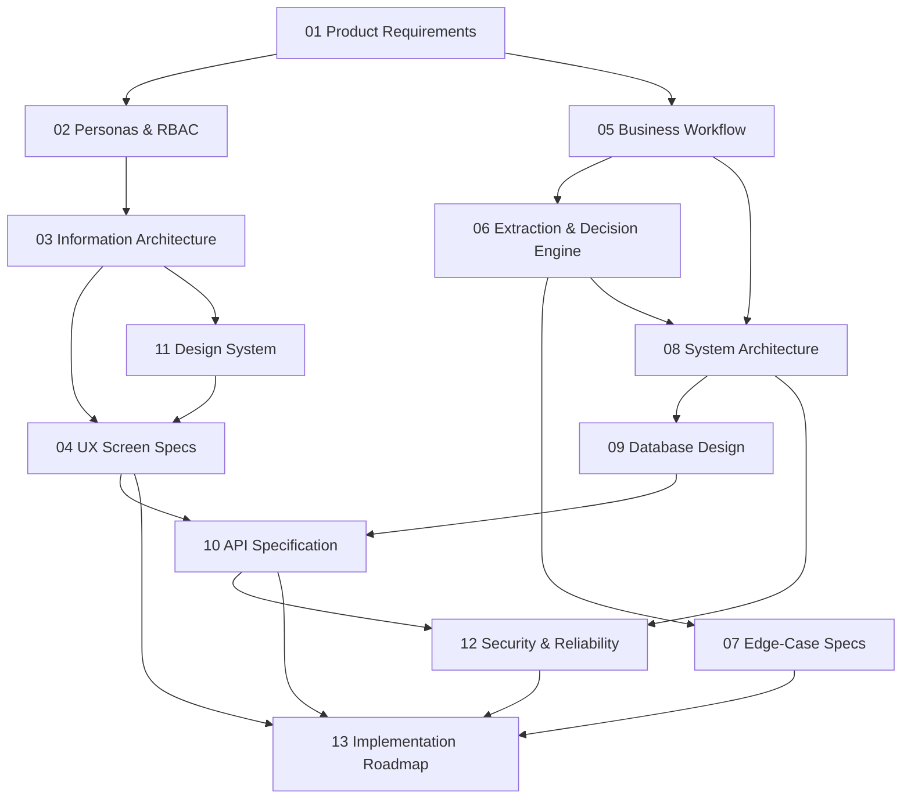

# InvoiceDesk — P0 Architecture Documentation

> **Status:** P0 Complete — Pending Architecture Review & Approval  
> **Product:** InvoiceDesk (AI-Powered Accounts Payable Automation Platform)  
> **Case Study Alignment:** AI Solutions Analyst — Problem Statement 1 (PS-1 · Finance / AP: Invoice processing — from PDF to decision)  

---

## 1. Executive Summary

**InvoiceDesk** transforms unstructured vendor invoice PDFs (both machine-readable and scanned documents) into verified, explainable Accounts Payable decisions (`APPROVE`, `REVIEW`, `REJECT`). Every automated outcome is produced by an **eight-stage observable pipeline** backed by persisted backend events, exact decimal financial arithmetic, deterministic policy rules, and an immutable audit trail.

### Core Architectural Tenets
1. **Separation of Concerns (AI vs. Deterministic Finance):** An LLM/OCR extraction layer converts unstructured PDFs into a strict, confidence-scored JSON schema—never inventing missing figures. A deterministic Python rule engine evaluates financial integrity, vendor verification, duplicate detection, PO matching, and tolerance checks using exact `Decimal` arithmetic.
2. **Backend as Single Source of Truth:** Processing progress is persisted in PostgreSQL (`processing_runs` and `stage_events`) and streamed to the browser via Server-Sent Events (SSE) with `Last-Event-ID` replay. The frontend never simulates progress.
3. **Three Orthogonal Status Axes:** `processing_status` (pipeline execution), `business_decision` (automated outcome), and `review_status` (human exception resolution) are modeled independently so retries and human overrides never overwrite historical truth.
4. **Live Demo & Case Study Readiness:** Prioritizes a genuinely executable end-to-end workflow with real PDF inputs, an 8-stage live execution workspace, a run-history dashboard, and four non-trivial edge cases (`E1`–`E4`).

---

## 2. Repository Inspection & Baseline Context

An inspection of the current workspace revealed a clean starter template:
- **Frontend template:** React 19, Vite 8, TypeScript, Tailwind CSS v4 (`@tailwindcss/vite`), `lucide-react`, `motion`.
- **Server stub / dependencies:** `express`, `tsx`, `@google/genai`, `dotenv` in `package.json`, with no existing backend server entry point (`server.ts`), no database layer, and no existing InvoiceDesk business logic (`src/App.tsx` renders an empty `
`).
- **Case Study Reference:** `/public/assets/aistudio/ASA_Case_Study___Candidate_Guide_fbd78348.pdf`.

Because there is no pre-existing InvoiceDesk business logic to migrate, **P1–P8 start from a clean greenfield baseline**. See [`08-system-architecture.md`](./08-system-architecture.md) for the explicit architectural decision comparing the recommended **FastAPI + PostgreSQL** backend against the starter workspace's **Node/Express** environment and runtime deployment implications.

---

## 3. Documentation Index & Reading Order

| # | Document | Primary Focus | Key Dependencies |
| :--- | :--- | :--- | :--- |
| **01** | [`01-product-requirements.md`](./01-product-requirements.md) | AP problem discovery, personas context, functional/NFRs, assignment vs. enterprise scope | Case Study Guide |
| **02** | [`02-user-personas-and-permissions.md`](./02-user-personas-and-permissions.md) | Admin, AP Manager/Reviewer, AP Operator personas, JTBD, RBAC matrix, Auth model | Doc 01 |
| **03** | [`03-information-architecture.md`](./03-information-architecture.md) | 4-group navigation hierarchy, global upload, search (`Cmd+K`), notifications, breadcrumbs | Docs 01, 02 |
| **04** | [`04-ux-screen-specifications.md`](./04-ux-screen-specifications.md) | Complete specs for all 10 screens (layout, states, mobile behavior, API links) | Docs 02, 03, 10, 11 |
| **05** | [`05-business-workflow.md`](./05-business-workflow.md) | 8-stage processing pipeline, inputs/outputs, retries, DB events, state machine | Docs 01, 06 |
| **06** | [`06-extraction-and-decision-engine.md`](./06-extraction-and-decision-engine.md) | OCR + LLM extraction schema, provider abstraction, 16 deterministic rules, PO balance math | Docs 05, 09 |
| **07** | [`07-edge-case-specifications.md`](./07-edge-case-specifications.md) | Detailed specs & test cases for E1–E4 + 5-minute demo script | Docs 05, 06, 10 |
| **08** | [`08-system-architecture.md`](./08-system-architecture.md) | Modular monolith (React + FastAPI + PostgreSQL + SSE), repo baseline & runtime trade-offs | Docs 05, 06 |
| **09** | [`09-database-design.md`](./09-database-design.md) | 12-table PostgreSQL schema, `NUMERIC` precision, indexes, locking, ER diagram | Docs 05, 06, 08 |
| **10** | [`10-api-specification.md`](./10-api-specification.md) | REST endpoints for all 10 screens, SSE event stream schemas, error envelopes | Docs 02, 04, 08, 09 |
| **11** | [`11-design-system.md`](./11-design-system.md) | Stripe/Linear/Ramp-inspired tokens (Light & Dark), typography, 14 component specs | Docs 03, 04 |
| **12** | [`12-security-and-reliability.md`](./12-security-and-reliability.md) | Upload hardening, prompt injection defense, idempotency, atomic PO locks, audit integrity | Docs 08, 09, 10 |
| **13** | [`13-implementation-roadmap.md`](./13-implementation-roadmap.md) | Phased execution plan (P0–P8), dependencies, acceptance criteria, regression tests | All Docs (01–12) |

---

## 4. Document Dependency Graph

---

## 5. Unresolved Architectural Decisions Register

The following decisions are documented with recommended defaults across the architecture suite and require stakeholder sign-off prior to **P1**:

| ID | Decision Topic | Recommended Default | Alternative | Impacted Docs |
| :--- | :--- | :--- | :--- | :--- |
| **DEC-01** | Backend Runtime Alignment with Preview Container | **Option A (Target):** Python 3.12 + FastAPI + PostgreSQL (per Section 11 spec). **Option B (Container-Native):** If the hosted preview container only runs Node.js (`server.ts`), implement identical API/schema contracts in TypeScript + Express + PostgreSQL/SQLite or run FastAPI as a sidecar. | Pure Python FastAPI deployed separately | `08`, `09`, `13` |
| **DEC-02** | Initial Authentication UX for Live Demo | Email/password JWT cookie auth **plus** a clearly labeled non-production Demo Role Switcher (`Operator` / `Reviewer` / `Admin`) enabled only when `APP_ENV=demo`. | Strict login-only (requires logging out/in during 5-min demo) | `02`, `10`, `12` |
| **DEC-03** | Default LLM Extraction Provider | Provider-independent `ExtractionProvider` interface defaulting to **Gemini (`gemini-2.5-flash`)** with structured JSON output + multimodal PDF/page support, swappable via `LLM_PROVIDER` env var. | OpenAI `gpt-4o-mini` or Anthropic `claude-3-5-sonnet` | `06`, `08`, `12` |
| **DEC-04** | OCR Engine Strategy | **Tesseract (`pytesseract` + `pdf2image`/`pypdfium2`)** for deterministic local OCR text layer + Gemini Vision fallback for severely skewed/hand-annotated scans. | Cloud-only OCR (AWS Textract / Document AI) | `06`, `08` |
| **DEC-05** | Async Processing Mechanism | FastAPI `BackgroundTasks` / in-process `asyncio` bounded worker queue (`asyncio.Semaphore`) backed by PostgreSQL `stage_events` (no Redis required for 1-week scope). | Celery + Redis | `08`, `12`, `13` |
| **DEC-06** | Default Tolerance Policy | `±2.0%` percentage tolerance OR `±$10.00` absolute cap (whichever is **smaller**, i.e., `min(2% of PO, $10.00)`), configurable in Settings. | Flat percentage only | `06`, `09` |
